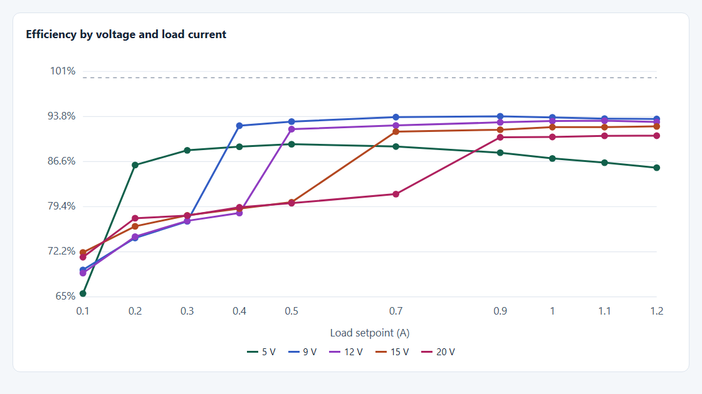

# Auto Bench Efficiency

Automatic DC power-transfer measurements with a **RIDEN RK6006 supply** and an
**ATORCH DL24P electronic load**. Choose supply voltages and load currents, run
a sweep, and view the results as an HTML graph and table or export them as CSV.

Efficiency is measured between the supply output and the load input, across
your device under test or cable.

## Installation

On Windows, install Python 3 and Git, then run in PowerShell:

```powershell
git clone --recurse-submodules https://github.com/misch2/auto-bench-efficiency.git
cd auto-bench-efficiency
py -3 -m venv .venv
.\.venv\Scripts\python.exe -m pip install -r requirements.txt
```

For an existing checkout, fetch the included RK6006 library with
`git submodule update --init --recursive` before installing dependencies.

## Run a measurement

Connect both instruments over USB serial and set the ATORCH to **CC mode**.
List the available COM ports:

```powershell
.\.venv\Scripts\python.exe .\measure_efficiency.py --list-ports
```

Run a sweep, replacing `COM4` (RK6006) and `COM3` (ATORCH) with your ports:

```powershell
.\.venv\Scripts\python.exe .\measure_efficiency.py --source-port COM4 --load-port COM3 --voltages 5 9 12 --currents 0.1 0.5 1 --source-current-limit 2 --seconds 10
```

This measures every voltage/current combination for 10 seconds after settling.
Choose voltages, load currents, and a source current limit appropriate for your
device. The source current limit applies to the device's input current, which
may differ from the load current.

Press **Ctrl+C** to stop. By default, both outputs turn off when the run ends.

The console prints the run's folder under `results/`. Open **`results.html`**
in a browser to view the graph and table, or use **`results.csv`** for further
analysis. Completed points are saved as the test progresses.

For all command options, including startup delays and keeping the source powered:

```powershell
.\.venv\Scripts\python.exe .\measure_efficiency.py --help
```

## Example output

A real 50-point run at 5, 9, 12, 15, and 20 V:



[HTML report](examples/results.html) · [CSV data](examples/results.csv)

The first two CSV rows:

```csv
set_v,set_a,window_s,samples,source_v,source_a,source_w,source_wh,load_v,load_a,load_w,load_wh,efficiency_pct,attempts
5,0.1,20,37,4.99,0.2555450478,1.275169789,0.007084276603,8.329063475,0.1003236241,0.8356019242,0.004642232912,65.52867953,1
5,0.2,20,37,4.99,0.3684811487,1.838720932,0.01021511629,7.905114063,0.2001554247,1.58225139,0.008790285499,86.05174186,1
```
